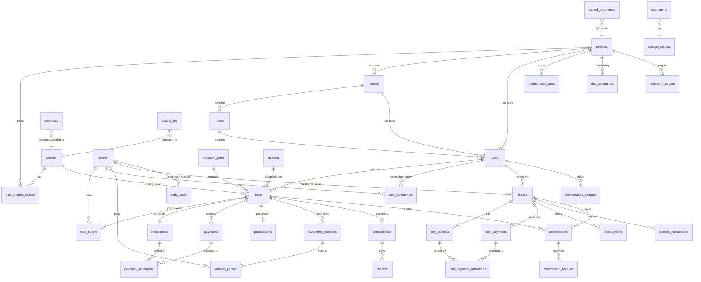

# Waystar Property Management Portal — Architecture Proposal (Step 1)

> Status: **DRAFT — awaiting approval.** No app code has been written yet.
> Full DDL draft: [`schema-proposal.sql`](./schema-proposal.sql). After approval it gets split into
> numbered files under `supabase/migrations/`.

---

## 1. Folder structure

```
portal/                                   (repo root)
├─ .github/workflows/ci.yml               lint + typecheck + vitest + supabase db test
├─ docs/                                  this proposal, ERD, business-rules decisions
├─ supabase/
│  ├─ config.toml
│  ├─ migrations/
│  │  ├─ 20261021000100_extensions_enums.sql
│  │  ├─ 20261021000200_core_auth_roles.sql        profiles, user_project_access, helpers
│  │  ├─ 20261021000300_inventory.sql              projects, blocks, floors, units
│  │  ├─ 20261021000400_clients.sql
│  │  ├─ 20261021000500_audit.sql                  activity_log + generic trigger
│  │  ├─ 2026…_sales_plans_installments.sql        (Phase 2)
│  │  ├─ 2026…_payments_receipts.sql               (Phase 2)
│  │  ├─ 2026…_possession_transfers_cancel.sql     (Phase 3)
│  │  ├─ 2026…_documents_storage.sql               (Phase 3)
│  │  ├─ 2026…_rentals.sql                         (Phase 4)
│  │  └─ 2026…_reporting_views_cron.sql            (Phase 5)
│  ├─ seed.sql                              5 projects + sample data
│  └─ tests/                                pgTAP: RLS, constraints, triggers
│     ├─ rls_roles.test.sql
│     ├─ double_booking.test.sql
│     └─ payments_immutable.test.sql
├─ src/
│  ├─ app/
│  │  ├─ (auth)/login/  (auth)/forgot-password/  (auth)/reset-password/
│  │  ├─ (portal)/                          authenticated shell (sidebar, topbar, global search)
│  │  │  ├─ dashboard/
│  │  │  ├─ projects/[projectId]/inventory/       grid + table views
│  │  │  ├─ units/[unitId]/                       tabs: overview, ownership, ledger, schedule,
│  │  │  │                                         payments, possession, leases, documents, activity
│  │  │  ├─ clients/  clients/[clientId]/
│  │  │  ├─ bookings/new/                         multi-step wizard
│  │  │  ├─ sales/[saleId]/
│  │  │  ├─ payments/  payments/new/  payments/cheques/
│  │  │  ├─ recoveries/                           due today / week / aging buckets
│  │  │  ├─ possession/
│  │  │  ├─ transfers/  transfers/new/
│  │  │  ├─ cancellations/
│  │  │  ├─ rentals/  rentals/[leaseId]/  rentals/invoices/
│  │  │  ├─ commissions/
│  │  │  ├─ reports/[report]/
│  │  │  └─ settings/ (projects, plans, numbering, users, company)
│  │  ├─ verify/[token]/                     PUBLIC QR verification page (minimal data)
│  │  └─ api/pdf/[doc]/[id]/route.ts         streams @react-pdf documents
│  ├─ components/
│  │  ├─ ui/                                 shadcn/ui
│  │  ├─ data-table/                         TanStack wrapper (server pagination, CSV export)
│  │  ├─ forms/  charts/  layout/
│  ├─ features/                              one folder per domain
│  │  └─ sales/ { actions.ts, queries.ts, schemas.ts, components/ }
│  │     (same for units, clients, payments, installments, possession, transfers, rentals, reports)
│  ├─ lib/
│  │  ├─ supabase/ { server.ts, client.ts, middleware.ts, admin.ts (server-only) }
│  │  ├─ money.ts        Decimal-based math + `Rs 1,250,000` formatter (no JS floats)
│  │  ├─ dates.ts        DD-MMM-YYYY, Asia/Karachi
│  │  ├─ cnic.ts         validation/masking
│  │  ├─ schedule/       pure installment-generator + allocation logic (mirrors SQL, unit-tested)
│  │  └─ auth/           role guards for server actions
│  ├─ pdf/               react-pdf templates + shared branded layout
│  ├─ types/database.ts  generated by `supabase gen types`
│  └─ middleware.ts      session refresh + route protection
├─ tests/ (vitest unit tests for lib/schedule, money, allocation)
├─ .env.example
└─ README.md
```

**Principle:** money and status logic lives in **Postgres functions** (single source of truth, atomic,
enforceable under RLS). The TS `lib/schedule` copy exists only for live preview in the wizard and is
tested against the same fixtures as the SQL version.

---

## 2. ERD



(Polymorphic `documents`, `approvals`, `activity_log`, `issued_documents` reference any entity via
`entity_type` + `entity_id`.)

---

## 3. Key design decisions

| Topic | Decision |
|---|---|
| Keys / audit cols | UUID v4 PKs; `created_at`, `updated_at` (trigger), `created_by` (default `auth.uid()`), `deleted_at` soft delete on master/transactional tables. |
| Money | `numeric(14,2)` everywhere; percentages `numeric(5,2)`. App uses `decimal.js`, never `number` for money. |
| Area | Store entered `size_value + size_unit` **and** normalized `area_sqft` (used for pricing & maintenance). Marla→sqft factor is a **per-project setting** (see Q1). |
| Ownership | `sale_buyers` = who bought; `unit_ownerships` = time-sliced ownership (valid_from / valid_to) written on booking, transfer and cancellation → full history always reconstructable. |
| Double booking | Partial unique index: one sale per unit where status in (`booked`,`active`); one lease per unit where status = `active`. |
| Unit status | Derived by trigger function `refresh_unit_status(unit_id)` called after any change to sales, payments, leases. Manual statuses `on_hold` / `blocked` only when no live sale/lease. |
| Installments | Generated by `generate_installment_schedule(sale_id)`; rounding remainder to last installment of each bucket. Manual edits allowed only through `edit_installment(...)` which requires a reason (logged). |
| Payments | Never deleted (trigger raises). Reversal = `reverse_payment(id, reason)` → status `reversed`, allocations removed, installments recomputed. Cheque payments only count toward "paid" once `cleared`. |
| Allocation | `allocate_payment(payment_id)` oldest-due-first (down payment → installments → possession); manual override via `set_payment_allocations(payment_id, jsonb)`. Installment `amount_paid`/`status` are recomputed from allocations, never typed in. |
| Numbering | `doc_sequences(project_id, doc_type, year)` + `next_doc_no()` with row lock → gap-free per project, e.g. `SV-RCPT-2026-000123`. |
| Audit | Generic `audit_row()` trigger → `activity_log` (old/new jsonb, `auth.uid()`, optional reason via `set_config('app.reason', …)`). |
| Approvals | `approvals` table for discounts above threshold, cancellations, transfers, possession overrides, schedule edits. Manager/Super Admin decide. |
| Client portal (later) | `clients.auth_user_id` (nullable, unique) + `client` role. RLS policies already include a "client sees own rows" branch → no refactor. |
| Files | Private buckets `client-docs`, `sale-docs`, `lease-docs`, `unit-media`; path `{entity_type}/{entity_id}/{uuid}-{filename}`; storage RLS mirrors table RLS; signed URLs (60s). |
| QR verify | `issued_documents` stores doc no + random token; `/verify/[token]` shows only doc type, number, date, project, unit no and a masked name. |
| Cron | `pg_cron`: 00:30 PKT mark overdue + days overdue; 01:00 generate rent invoices; 01:30 apply lease increments; 02:00 refresh expiry alerts. |
| Security | RLS on every table; helper functions in a non-exposed `private` schema (`security definer`, fixed `search_path`); service role key only in `lib/supabase/admin.ts` with `import 'server-only'`. |

---

## 4. Role matrix (RLS summary)

| Area | Super Admin | Manager | Sales Agent | Accounts | Viewer (SIMCO) | Client (later) |
|---|---|---|---|---|---|---|
| Projects / units config | CRUD | CRUD | read | read | read | own unit |
| Unit price edits | ✔ | ✔ | ✘ | ✘ | ✘ | ✘ |
| Clients | CRUD | CRUD | create + read/edit own* | read | read | own profile |
| Sales / bookings | CRUD | CRUD + approve | create, read own | read | read | own |
| Installment schedule edit | ✔ | ✔ (approval) | ✘ | request | ✘ | read own |
| Payments / receipts | ✔ | ✔ | read own sales | create, clear, reverse | read | read own |
| Cancellations / refunds | ✔ | approve | request | process refund | read | — |
| Transfers / NDC | ✔ | approve | request | fee + NDC check | read | — |
| Leases / rent | ✔ | ✔ | create, read own | collect rent | read | own |
| Reports / dashboard | ✔ | ✔ | own figures | ✔ | ✔ | — |
| Users, settings, hard deletes | ✔ | ✘ | ✘ | ✘ | ✘ | ✘ |

All non-admin access is further limited by `user_project_access` (see Q11).
\*see Q10.

---

## 5. Open business-rule questions (please answer before Phase 1/2)

1. **Marla size** — for Simco Villas, is 1 marla = **225 sq ft** or **272.25 sq ft**? 1 kanal = 20 marla?
2. **Plan base** — are 40/50/10 percentages applied to the **final price after discount**?
3. **Due dates** — down payment due on booking date? First installment one period after booking? Possession 10% has **no fixed date** until SIMCO announces possession (then due within X days)?
4. **"Sold" trigger** — unit becomes `sold` on the first *cleared* payment of any amount, or only when the **full down payment** is cleared?
5. **Late fees** — is there a late-payment surcharge? (flat Rs / % per month, grace days?) Same for rent?
6. **Commission (sales)** — 5% of final sale price, earned at booking or **pro-rata as collections arrive**? Who pays it (SIMCO to Waystar)? Is the closing agent/dealer's share tracked here too (and what %)?
7. **Commission (leases)** — 5% of what: one year's rent, total lease value, or each month's collected rent?
8. **Cancellation** — standard deduction (e.g. X% of price or of amount paid)? Is the refund paid in one go or in instalments?
9. **Transfers** — transfer fee fixed per project, per marla/sq ft, or % of price? Does NDC require *all* dues to date cleared (overdue = 0)? Does a transfer move the remaining installment schedule to the new owner (my assumption: yes, same sale continues)?
10. **Agents & clients** — can an agent see all clients (to avoid duplicates by CNIC) or only clients they created/sold to? (Proposal: CNIC lookup across all, full profile only for own.)
11. **Project restriction** — should Manager / Accounts / Viewer be restricted per project too, or always all projects? (Proposal: Super Admin + Manager = all; others per `user_project_access`.)
12. **Discount approval** — any discount needs Manager approval, or only above a threshold (e.g. > 2%)?
13. **Rentals** — does Waystar **collect rent on the owner's behalf** (needs owner payout tracking) or only record what the tenant pays the owner? Is the rental unit always owned by a client, or can SIMCO itself be landlord for unsold units?
14. **Maintenance charges** — billed to owner or tenant when rented? Monthly/quarterly? Rate per project or per category (shop vs apartment)?
15. **Receipt numbering** — format OK as `SV-RCPT-2026-000123`, resetting yearly? Separate series for rent receipts?
16. **Currency** — any payments in USD/AED from overseas clients that must be recorded in original currency + PKR equivalent, or PKR only?
17. **Possession override / waivers** — who may waive installments or late fees (Manager only)?

---

## 6. Environment notes

- This folder is empty and **not yet a git repo** — I'll `git init` (or you can point me at the cloned repo).
- **Node.js and the Supabase CLI are not installed** on this machine. Before Phase 1 please install:
  Node 20 LTS+, then `npm i -g supabase` (or Scoop), and Docker Desktop for local Supabase.
